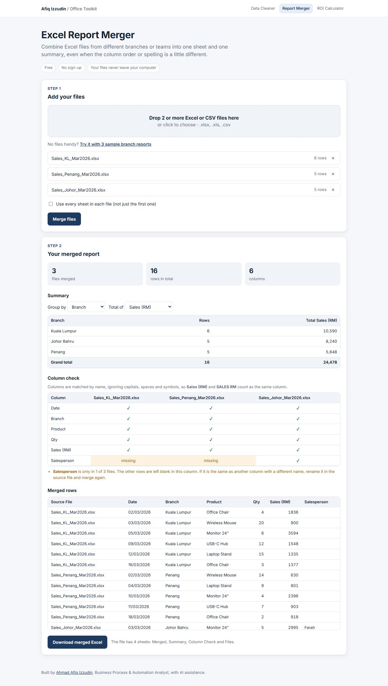

# Excel Report Merger

Combine Excel files from different branches or teams into one sheet and one summary, even when the columns do not line up.

**[Open the live tool](https://afiqizzudinnn.github.io/excel-report-merger/)** · [See it with sample data](https://afiqizzudinnn.github.io/excel-report-merger/?demo)

## The problem

Every month, someone collects a file from each branch or team and copy-pastes them into one master sheet. It goes wrong in quiet ways:

- one branch puts the columns in a different order
- another writes `SALES (RM)` instead of `Sales (RM)`
- someone adds an extra column nobody asked for
- rows get pasted twice, or missed

Then the summary has to be built by hand, and nobody can tell which row came from which file.

## What it does

- **Merges any number of files** (`.xlsx`, `.xls`, `.csv`), using the first sheet or every sheet.
- **Matches columns by name**, ignoring capitals, spaces and symbols, so `Sales (RM)` and `SALES RM` land in the same column, whatever the order.
- **Adds a Source File column**, so every row can be traced back to where it came from.
- **Builds the summary for you**: pick a column to group by (e.g. Branch) and a column to total (e.g. Sales), with a grand total.
- **Runs a column check** that flags any column missing from some files, before it causes a wrong total.

The download has 4 sheets: Merged, Summary, Column Check and Files.

## Safe by design

- **Your files never leave your computer.** Everything runs inside the browser. Nothing is uploaded.
- **Dates stay real dates** and numbers stay numbers, so the merged sheet works with formulas and pivot tables straight away.
- **Nothing is silently dropped.** Columns that exist in only some files are kept and flagged.

## Business impact (estimate)

If a team merges branch reports every week and it takes 30 minutes by hand, the tool saves about **26 hours a year** (30 min × 52 weeks), and removes copy-paste mistakes from the monthly numbers. Try your own numbers in the [Automation ROI Calculator](https://afiqizzudinnn.github.io/automation-roi-calculator/).

## How to use

1. Open the [live tool](https://afiqizzudinnn.github.io/excel-report-merger/).
2. Drop in 2 or more files, or click **Try it with 3 sample branch reports**.
3. Click **Merge files**.
4. Pick what to group by and what to total, check the column check, then click **Download merged Excel**.

## How it is built

- One `index.html` file. No server, no database, no install.
- [SheetJS](https://sheetjs.com/) reads and writes Excel files in the browser.
- Plain JavaScript matches the headers, merges the rows and builds the summary.

To run it on your own computer, download `index.html` and open it in Chrome or Edge. It needs internet once to load SheetJS.

## About

Built by **Ahmad Afiq Izzudin**, Business Process & Automation Analyst. I designed the process and the matching rules, and used AI assistance to write the code faster.

[LinkedIn](https://www.linkedin.com/in/afiq-izzudin-27aaa936b) · Part of my Office Toolkit, together with the [Excel Data Cleaner](https://github.com/Afiqizzudinnn/excel-data-cleaner) and the [Automation ROI Calculator](https://github.com/Afiqizzudinnn/automation-roi-calculator).

All sample data is made up. Licensed under MIT.
